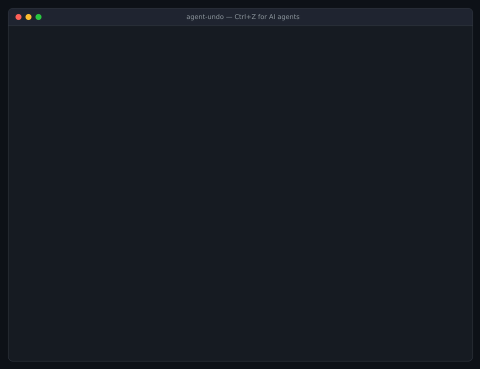

# agent-undo

**Ctrl+Z for AI agents.** A drop-in MCP proxy that snapshots your files before every action an agent takes, so you can roll back anything it did — one step, or ten.

<!-- Record this GIF: agent deletes a folder → `agent-undo last` → folder is back. It's the whole pitch. -->
<!--  -->

```
$ agent-undo list
✓   1  11:54:04  write     write_file   {"path":"report.md","content":"# Q3"}
✓   2  11:54:04  write     delete_file  {"path":"important.txt"}
✓   3  11:54:04  external  send_email   {"to":"boss@example.com","subject":"done"}

$ agent-undo rollback 2
Roll back to just before step #2 (delete_file)
  2 step(s) reverted, 1 file(s) change:
    restore important.txt
  ⚠ #3 send_email reached the outside world and can't be undone.
Proceed? [y/N] y
✓ Done. Recorded as step #4; undo it with: agent-undo rollback 4
```

## Why

Agents are great until one runs `rm -rf` on the wrong folder, rewrites a config you needed, or "cleans up" half your project. Git doesn't help if you hadn't committed, and most agents don't checkpoint per action.

`agent-undo` sits between your agent and its tools. It works with **any MCP client** (Claude Desktop, Claude Code, Cursor, Windsurf, VS Code…) and **any MCP server**, with zero changes to either.

- **Per-action snapshots** before every write, delete, move or shell command
- **Timeline** of everything the agent did (`list`, `show`, `diff`)
- **Rollback** to any step, and the rollback itself can be undone
- **Irreversible-action guard** that flags (or blocks) emails, payments, posts and other calls that can't be taken back
- **Zero runtime dependencies.** Uses Node's built-in SQLite and your system `git`
- Never touches your project's own `.git`

## Quick start

Requires Node 22.13+ and git.

Wrap any MCP server by putting `npx agent-undo wrap --root <folder> --` in front of its command. For Claude Desktop (`claude_desktop_config.json`):

```json
{
  "mcpServers": {
    "filesystem": {
      "command": "npx",
      "args": [
        "-y", "agent-undo", "wrap", "--root", "/Users/you/project", "--",
        "npx", "-y", "@modelcontextprotocol/server-filesystem", "/Users/you/project"
      ]
    }
  }
}
```

Then, from that folder:

```bash
npx agent-undo list           # what did the agent do?
npx agent-undo diff 7         # what exactly did step 7 change?
npx agent-undo rollback 7     # put files back to just before step 7
npx agent-undo last           # undo the most recent step
```

More examples in [`examples/`](examples).

## How it works

```
agent (MCP client) ⇄ agent-undo proxy ⇄ real MCP server
                          │
                          ├─ .undo/repo    hidden git repo of snapshots
                          └─ .undo/log.db  SQLite timeline of every action
```

MCP talks JSON-RPC over stdin/stdout. The proxy spawns the real server as a child process and passes every message through untouched — except `tools/call`, which goes through:

1. **Classify** the call as `read`, `write` or `external`, using your config first, then the server's tool annotations (`readOnlyHint`, `openWorldHint`, `destructiveHint`), then the tool name. Unknown tools are treated as `write`, so they get a snapshot.
2. **Wait** for any earlier write still running, so a snapshot never captures half-written files.
3. **Snapshot** the folder (`git add -A && git commit` into `.undo/repo`, which is cheap thanks to git's content-addressed storage).
4. **Forward** the call. In `block` mode, external calls are refused with an explanation the agent can read.
5. **Record** the result in the timeline.

Rollback uses `git read-tree -u --reset <snapshot>`, which restores changed files, brings back deleted ones and removes files the agent created. A safety snapshot is taken first, so every rollback is itself reversible.

## Configuration

Optional `undo.config.json` in the root folder:

```json
{
  "guard": "log",
  "logReads": false,
  "tools": {
    "run_sql": "write",
    "create_invoice": "external",
    "get_weather": "read"
  }
}
```

| Key | Default | Meaning |
|---|---|---|
| `guard` | `"log"` | `"block"` refuses external actions (email, payments, posts…) |
| `logReads` | `false` | Also record read-only calls in the timeline |
| `tools` | `{}` | Force a tool to `read`, `write` or `external` |
| `dataDir` | `".undo"` | Where snapshots and the log live |

Add `.undo/` to your project's `.gitignore`.

## Limits

- Only files inside `--root` are protected. Files ignored by your `.gitignore` (e.g. `.env`) aren't snapshotted, and are never deleted on rollback.
- Databases, remote APIs and anything outside the folder aren't restored yet (see roadmap).
- External actions are recorded and flagged, not reversed. Nobody can un-send an email.
- Very large or binary-heavy folders make snapshots slower. Point `--root` at the working folder, not your whole home directory.

## Roadmap

- [ ] `v0.2` Database rollback (SQLite/Postgres via savepoints and inverse SQL)
- [ ] `v0.2` Local web timeline UI (`agent-undo ui`)
- [ ] `v0.3` Python decorator `@undoable` for non-MCP agents (LangChain, custom loops)
- [ ] `v0.3` Compensating actions for external calls (e.g. register a refund for a charge)
- [ ] Snapshot size limits and pruning (`agent-undo gc`)
- [ ] HTTP/SSE transport (currently stdio servers only)

## Development

```bash
git clone https://github.com/<you>/agent-undo && cd agent-undo
npm install
npm test            # builds, then runs end-to-end tests against examples/demo-server.mjs
```

Project layout:

```
src/
  cli.ts        command line: wrap, list, show, diff, rollback, last
  proxy.ts      the interceptor (agent ⇄ proxy ⇄ server)
  classify.ts   read / write / external decision
  snapshot.ts   hidden git repo of snapshots
  log.ts        SQLite action timeline
  rollback.ts   plan + perform rollbacks
  config.ts     undo.config.json loading
  jsonrpc.ts    line-delimited JSON-RPC helpers
examples/
  demo-server.mjs    tiny MCP server for demos and tests
test/
  e2e.test.mjs
```

PRs welcome, see [CONTRIBUTING.md](CONTRIBUTING.md).

## License

MIT
